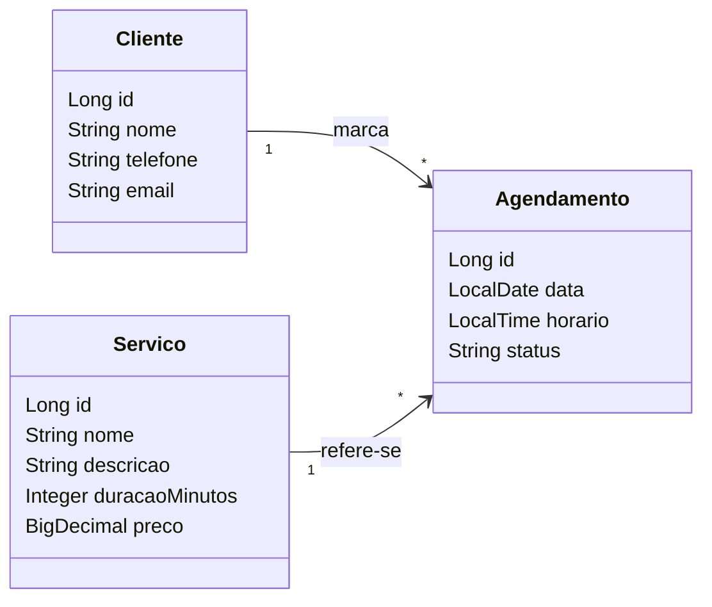
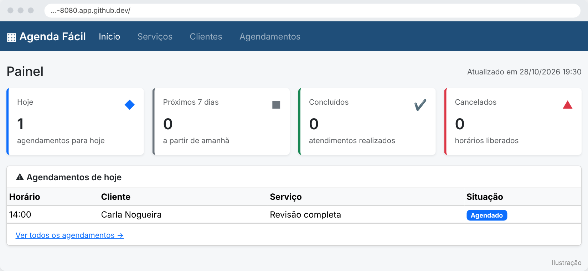
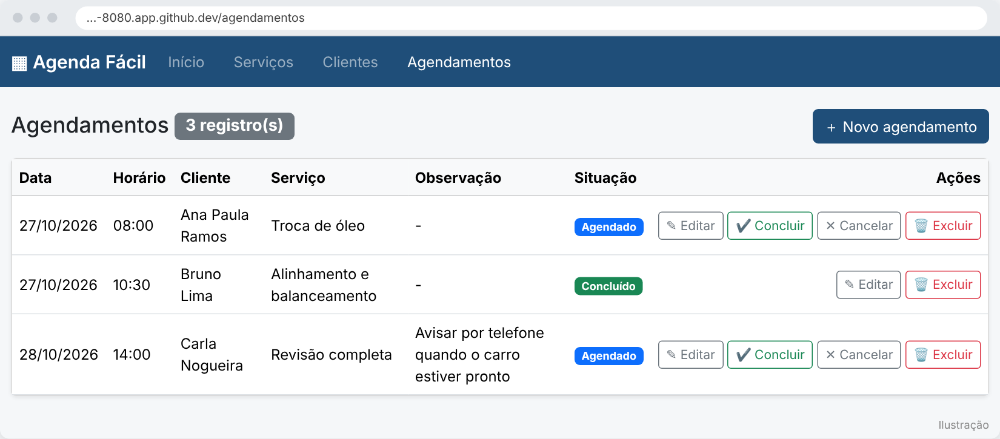
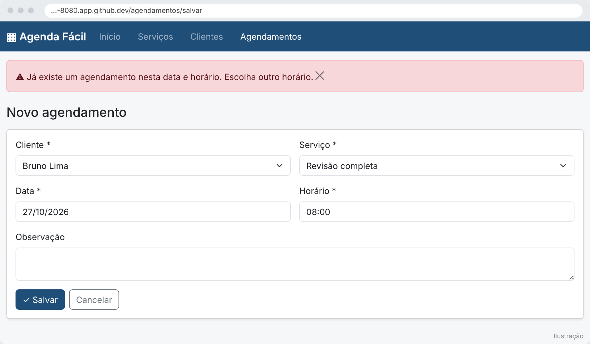
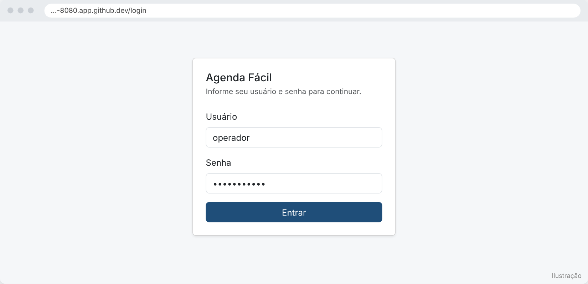

# Agenda Fácil

Sistema web de agendamento de serviços de uma **oficina mecânica de bairro**: cadastro de serviços e clientes, agenda por data e horário e painel com a agenda do dia.

> **Sistema recebido para manutenção.** A versão 1.0.0 foi desenvolvida por outra equipe e entregue em 11/11/2026.
> A partir dela, este repositório registra a manutenção do sistema: chamados, correções e novas versões.

| | |
|---|---|
| **Responsável pela manutenção** | Vinicius José Mendes Marigo |
| **Turma** | Manutenção de Sistemas |
| **Opção** | Agendamento de Serviços |
| **Versão atual** | 1.0.0 |

---

## 1. Visão geral

### 1.1 Problema
A oficina marca os atendimentos em um caderno e pelo WhatsApp. Acontecem dois clientes no mesmo horário, horários marcados em dias que já passaram e ninguém sabe, no começo do dia, quais carros vão chegar. O dono também não sabe quantos atendimentos foram concluídos ou cancelados.

### 1.2 Canvas do projeto

| Bloco | Resposta |
|---|---|
| **Usuários** (quem usa o sistema) | Dono da oficina (administrador) e atendente (operador) |
| **Problema** (dor atual) | Agenda no caderno e no WhatsApp: horários em conflito e falta de controle |
| **Proposta de valor** (o que melhora com o sistema) | Agenda única, sem conflito de horário, com a agenda do dia na tela inicial |
| **Funcionalidades principais** | Cadastro de serviços e clientes; agendamento; concluir e cancelar; painel |
| **Informações que o sistema guarda** | Serviços (duração e preço), clientes (contato) e agendamentos (data, horário, situação) |
| **Indicadores** (o que o gestor quer acompanhar) | Agendamentos de hoje, dos próximos 7 dias, concluídos e cancelados |
| **Restrições** (prazo, tecnologia, equipe) | Java 21 · Spring Boot 4 · uma pessoa responsável pela manutenção |

---

## 2. Requisitos

### 2.1 Requisitos funcionais (o que o sistema FAZ)

| ID | Requisito | Nível |
|---|---|---|
| RF01 | O sistema deve permitir cadastrar, listar, editar e excluir serviços. | Essencial |
| RF02 | O sistema deve permitir cadastrar, listar, editar e excluir clientes. | Essencial |
| RF03 | O sistema deve permitir agendar um serviço para um cliente, em uma data e horário. | Essencial |
| RF04 | O sistema deve permitir concluir ou cancelar um agendamento. | Essencial |
| RF05 | O sistema deve mostrar, na página inicial, os indicadores e a agenda do dia. | Essencial |
| RF06 | O sistema deve exigir login, com os perfis Administrador e Operador. | Essencial |

### 2.2 Requisitos não funcionais (COMO o sistema deve ser)

| ID | Requisito |
|---|---|
| RNF01 | O sistema deve ser acessado pelo navegador (aplicação web). |
| RNF02 | O sistema deve exigir login e senha; as senhas devem ser armazenadas criptografadas. |
| RNF03 | Só o Administrador cadastra, edita e exclui serviços e clientes; o Operador consulta e faz agendamentos. |

### 2.3 Regras de negócio (as REGRAS do negócio que o sistema precisa respeitar)

| ID | Regra |
|---|---|
| RN01 | Não é permitido agendar em uma data e horário já ocupados (agendamentos cancelados não contam). |
| RN02 | Não é permitido agendar em data e horário que já passaram. |
| RN03 | Só um agendamento na situação Agendado pode ser concluído ou cancelado. |
| RN04 | Duração e preço de um serviço não podem ser negativos. |

---

## 3. Histórias de usuário

**HU01 —** Como atendente, quero agendar um serviço para um cliente, para que ele tenha o horário garantido.
- Critério de aceite: o sistema não deixa agendar em um horário já ocupado.
- Critério de aceite: o sistema não deixa agendar no passado.

**HU02 —** Como dono da oficina, quero ver a agenda do dia na tela inicial, para organizar o trabalho logo cedo.
- Critério de aceite: o painel mostra os agendamentos de hoje em ordem de horário.

**HU03 —** Como dono da oficina, quero saber quantos atendimentos foram concluídos e cancelados, para acompanhar o movimento.
- Critério de aceite: o painel mostra os dois números, iguais aos da lista de agendamentos.

---

## 4. Modelo de dados



---

## 5. Como executar

### No GitHub Codespaces (recomendado)
1. No repositório, clique em **Code → Codespaces** e abra o Codespace existente (ou **Create codespace on main**).
2. No terminal, execute:
   ```bash
   mvn spring-boot:run
   ```
3. Aguarde a mensagem `Started SistemaApplication` no terminal.
4. Abra a aba **Portas** (ao lado do Terminal) e, na linha da porta **8080**, clique no ícone de globo (**Abrir no navegador**).
5. Entre com um dos usuários da seção **Usuários de teste**.

### No computador (ferramentas instaladas)
Requisitos: JDK 21 e Maven (ou uma IDE com suporte a Java, como IntelliJ IDEA ou VS Code com o *Extension Pack for Java*).
Na pasta do projeto, execute `mvn spring-boot:run` e acesse `http://localhost:8080`.

### Banco de dados de desenvolvimento
- O banco H2 fica na pasta `dados/` (não vai para o GitHub). Na primeira execução, o sistema cria as tabelas e os dados de exemplo.
- Para recomeçar com os dados de exemplo: pare o sistema e apague a pasta (`rm -rf dados`).
- Console do banco: endereço `/h2-console` (só para o perfil ADMIN).

---

## 6. Tecnologias
Java 21 · Spring Boot 4 · Spring MVC · Thymeleaf · Bootstrap 5 · Spring Data JPA · H2 (desenvolvimento) · MySQL (produção) · Spring Security · Git/GitHub

## 7. Uso de inteligência artificial
<!-- Registre aqui, de forma resumida, quando e como você usou ferramentas de IA de forma relevante na manutenção. -->

## 8. Histórico de versões
| Versão | Data | Descrição |
|---|---|---|
| 1.0.0 | 11/11/2026 | Primeira versão estável, entregue pela equipe de desenvolvimento e recebida para manutenção |

## Usuários de teste

| Usuário | Senha | Perfil | O que pode fazer |
|---|---|---|---|
| admin | admin123 | Administrador | Tudo |
| operador | operador123 | Operador | Consulta serviços e clientes, cria agendamentos e muda a situação deles |

## 9. Funcionalidades e telas

### Funcionalidades
- Cadastro de serviços e clientes.
- Agendamento de atendimentos por data e horário.
- Situação de cada agendamento: agendado, concluído ou cancelado.
- Painel com a agenda do dia.
- Login com dois perfis: o Administrador pode tudo; o Operador consulta serviços e clientes, cria agendamentos e muda a situação deles.

### Telas

**Painel com a agenda do dia**



**Agendamentos e suas situações**



**Regra de negócio: horário já ocupado**



**Tela de login**



## 10. Checklist do nível essencial

- [x] O sistema sobe sem erros seguindo a seção 5 (Como executar)
- [x] Cadastro completo de serviços (cadastrar, listar, editar e excluir), com validação
- [x] Cadastro completo de clientes, com validação
- [x] Agendamentos ligados a clientes e serviços, com lista de escolha no formulário
- [x] Regra de negócio 1: Não agendar em data e horário já ocupados (agendamentos cancelados não contam).
- [x] Regra de negócio 2: Não agendar em data e horário que já passaram.
- [x] Login com 2 perfis (admin e operador), senhas criptografadas e acesso conforme o perfil
- [x] Painel com os indicadores na página inicial
- [x] Repositório no GitHub com commits frequentes
- [x] README com a visão do projeto, como executar, usuários de teste, funcionalidades e telas
- [x] Quadro Kanban atualizado
